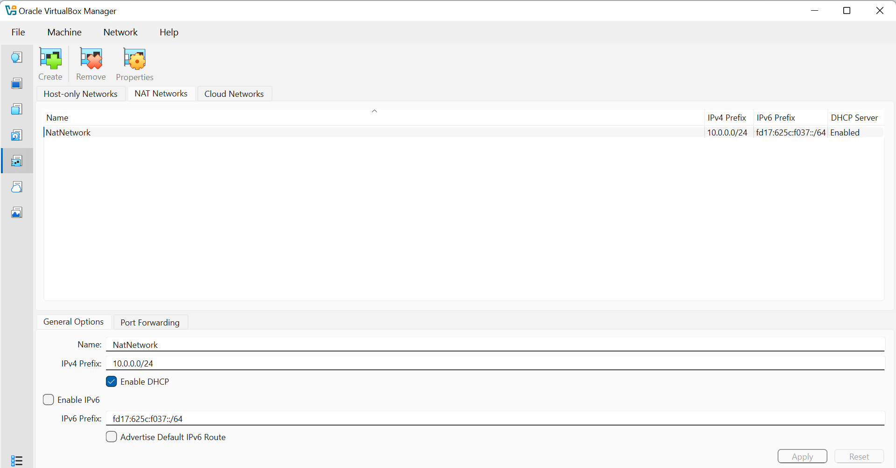
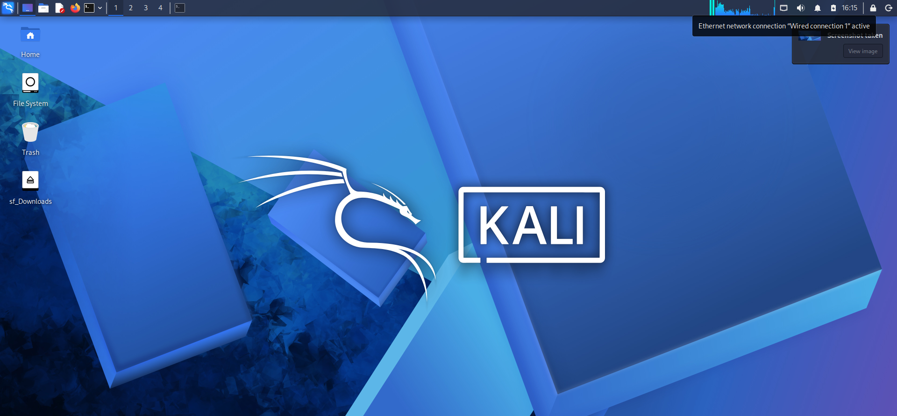
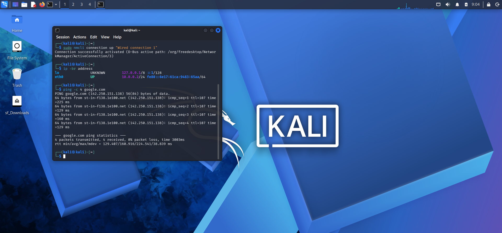
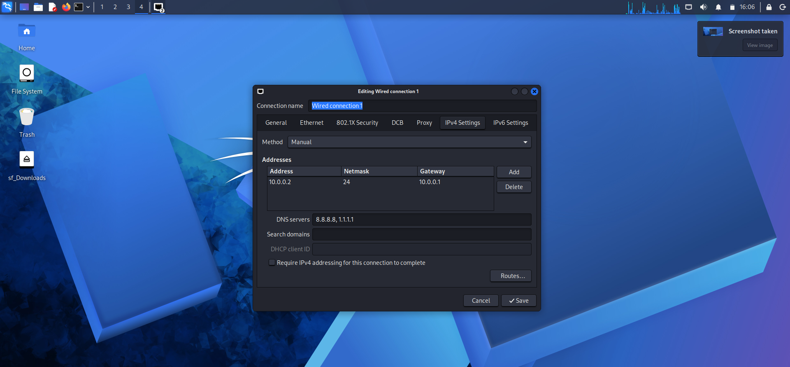

# My First Virtual Cybersecurity Lab

**Building and testing my own Kali Linux environment with VirtualBox**

---

## 1. About This Project

This project records my hands-on experience setting up my first virtual cybersecurity lab on an HP laptop running Windows. I used Oracle VirtualBox to run Kali Linux and configured the virtual machine to communicate through a dedicated NAT Network.

The main focus of this first lab was to get the environment working correctly, resolve configuration problems, confirm internet access, and create a snapshot so the virtual machine could be restored to a known state.

## 2. My Lab Configuration

| Component | My configuration |
|---|---|
| Host computer | HP laptop running Windows |
| Virtualisation software | Oracle VirtualBox 7.2.22 |
| Virtual machine | Kali Linux 2026.3 |
| Network name | `NatNetwork` |
| Network range | `10.0.0.0/24` |
| Kali Linux IP address | `10.0.0.2/24` |
| Gateway configured | `10.0.0.1` |
| DNS servers configured | `8.8.8.8` and `1.1.1.1` |
| Shared host folder | Windows Downloads |
| Recovery point | `week 1 kali setup` |

## 3. Work I Completed

- Installed the required extraction software and VirtualBox.
- Imported and started the Kali Linux virtual machine.
- Configured the NAT Network and connected Kali to it.
- Assigned Kali Linux a static IP address.
- Enabled shared clipboard and drag-and-drop functionality.
- Configured access to the Windows Downloads folder.
- Created a snapshot of the configured virtual machine.
- Tested internet connectivity from Kali Linux.

## 4. Testing and Results

I checked the network interface and confirmed that Kali Linux had the expected address, `10.0.0.2/24`.

I then ran `ping -c 4 google.com` in Kali Linux. The test returned four packets received out of four, with 0% packet loss. This confirmed that the virtual machine could reach the internet and resolve the hostname during the test.

## 5. Problems I Worked Through

### Hardware virtualisation

VirtualBox initially encountered a virtualisation-related startup problem. I entered the computer's BIOS settings and enabled hardware virtualisation, allowing me to continue with the virtual machine setup.

### Network configuration

I encountered a Duplicate Address Detection (DAD) timeout issue while configuring the static IP address. I set the NetworkManager DAD timeout to zero and reconnected the network interface before checking the address again.

### Package mirror issue

An initial package update encountered a temporary repository mirror size mismatch. I retried the update later and continued with the setup after it succeeded.

## 6. What I Learned

This lab helped me practise working with virtual machines, configuring a NAT Network, assigning a static IP address, checking DNS and internet connectivity, and troubleshooting a Linux network connection. I also learned the importance of saving a virtual machine snapshot before moving on to further lab activities.

## 7. Responsible Use

This environment is intended for cybersecurity education and authorised testing. Any future scanning or penetration-testing activities will be restricted to systems and networks for which I have permission.

## 8. Evidence and Screenshots

### 1. VirtualBox NAT Network Configuration

### 2. Kali Linux Desktop

### 3. Kali Network and Internet Connectivity Test

### 4. Kali Static IP Configuration

## 9. Project Resources

- [VirtualBox Downloads](https://www.virtualbox.org/wiki/Downloads)
- [Kali Linux Downloads](https://www.kali.org/get-kali/)
- [7-Zip Downloads](https://7-zip.org/download.html)

---

**Project status:** Week 1 lab setup completed. Documentation and screenshot evidence are being organised.

